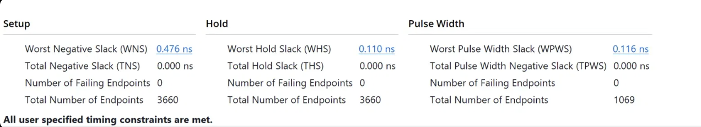
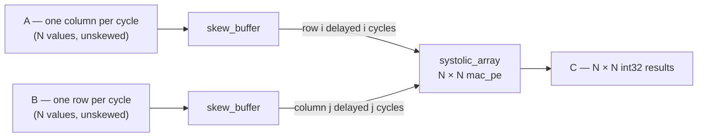

# 8×8 int8 Systolic Array GEMM Accelerator

A parameterized, output-stationary systolic array for int8 matrix multiplication, written in SystemVerilog and implemented on a Xilinx Artix-7 FPGA (xc7a35t).

Matrix multiplication is where neural network inference spends nearly all of its time. This design performs it the way dedicated ML hardware does: a grid of multiply-accumulate cells that pass operands to their neighbours, so every value fetched from memory is reused across an entire row or column of the array.

## Results

| Metric | Value |
|---|---|
| Array size | 8 × 8 (64 processing elements), parameterized on N |
| Data types | int8 inputs, int32 accumulation |
| Clock | **250 MHz** (timing met, WNS +0.476 ns) |
| Throughput | 64 MAC/cycle × 250 MHz = 16 GMAC/s = **32 GOPS** |
| DSP48E1 | 64 / 90 (71%) |
| LUTs | 96 / 20,800 (<1%) |
| Flip-flops | 949 / 41,600 (2.3%) |
| Latches | 0 |

Target: xc7a35tcpg236-1 (the Artix-7 on the Digilent Basys 3), Vivado 2026.1, out-of-context implementation. Utilization figures are post-synthesis; timing is post-implementation.

At 250 MHz the worst pulse-width slack is 0.116 ns, meaning the design is within about 3% of the DSP48E1 blocks' own maximum clock frequency on this speed grade. The array logic is not the limiting factor; the silicon is.



## Architecture



| Module | Role |
|---|---|
| `mac_pe.sv` | One processing element: `acc += a × b`, forwards `a` right and `b` down through registers |
| `systolic_array.sv` | N × N grid of `mac_pe`, built with a generate loop and wired neighbour-to-neighbour |
| `skew_buffer.sv` | Delays lane *i* by *i* cycles using a chain of *i* registers |
| `gemm_top.sv` | Two skew buffers feeding the array; accepts plain, unskewed matrix data |

### Dataflow: output stationary

Each cell owns one element of the output matrix. Its accumulator never moves. Rows of A stream left-to-right across the array, columns of B stream top-to-bottom, and each cell multiplies whatever pair of operands passes through it.

```
              B col 0   B col 1   B col 2
                 ↓         ↓         ↓
A row 0  →   [c00] →   [c01] →   [c02] →
                 ↓         ↓         ↓
A row 1  →   [c10] →   [c11] →   [c12] →
                 ↓         ↓         ↓
A row 2  →   [c20] →   [c21] →   [c22] →
```

Cells pass **operands** to their neighbours, never accumulators. Cell (*i*, *j*) computes Σₖ A[*i*][*k*] · B[*k*][*j*].

Because each hop costs one clock cycle, inputs must be staggered: row *i* of A enters *i* cycles late and column *j* of B enters *j* cycles late. With that skew, A[*i*][*k*] and B[*k*][*j*] arrive at cell (*i*, *j*) on the same cycle, *k + i + j*. The skew buffers do this in hardware.

A full N × N product with inner dimension K completes in about **K + 2(N − 1)** cycles. The 2(N − 1) fill and drain cost is fixed, so efficiency improves as K grows, which suits neural-network layers with long inner dimensions.

### Worked example (2 × 2)

```
A = [1 2]   B = [5 6]   C = [19 22]
    [3 4]       [7 8]       [43 50]
```

| Cycle | c00 | c01 | c10 | c11 |
|---|---|---|---|---|
| 0 | 0 + 1×5 = 5 | idle | idle | idle |
| 1 | 5 + 2×7 = **19** | 0 + 1×6 = 6 | 0 + 3×5 = 15 | idle |
| 2 | — | 6 + 2×8 = **22** | 15 + 4×7 = **43** | 0 + 3×6 = 18 |
| 3 | — | — | — | 18 + 4×8 = **50** |

Note that c11 never receives a value from c01 or c10's accumulators. Its operands are the *same* `a` and `b` values those cells used one cycle earlier, forwarded through their registers.

## Design decisions

**Output stationary over weight stationary.** Only 8-bit operands travel between cells; 32-bit partial sums stay put. Accumulators are local, so a failing test points directly at the cell that went wrong, and there is no separate weight-load phase to sequence. Weight-stationary designs (e.g. TPU v1) instead move partial sums between cells and amortize weight loading across large batches.

**int8 in, int32 accumulate.** An 8 × 8 signed product needs 16 bits, and summing K of them needs more. A 32-bit accumulator cannot overflow for any practical K. This matches the int8 inference pattern used in production accelerators.

**Neighbour-to-neighbour forwarding instead of broadcast.** Broadcasting each input to all N cells in a row would create long, high-fanout wires that limit clock speed as N grows. Registered hops keep every wire short, which is the core physical reason systolic arrays scale.

**Forcing DSP inference.** On the first implementation Vivado mapped all 64 multipliers to general-purpose logic: 6,554 LUTs, 0 DSPs, and a failed 200 MHz constraint (~132 MHz achieved). Adding `(* use_dsp = "yes" *)` to `mac_pe` moved each multiply-accumulate into a DSP48E1 slice, including the accumulator register.

| | General logic | DSP48E1 | Change |
|---|---|---|---|
| LUTs | 6,554 | 96 | −98.5% |
| Flip-flops | 3,174 | 949 | −70% |
| DSPs | 0 | 64 | |
| Fmax | ~132 MHz | 250 MHz (verified) | ~1.9× |

## Verification

All testbenches are self-checking and report PASS / FAIL without manual inspection.

| Testbench | Device under test | What it checks |
|---|---|---|
| `mac_pe_tb.sv` | `mac_pe` | Directed tests: accumulation, operand forwarding, signed (negative) arithmetic |
| `systolic_array_tb.sv` | `systolic_array` | Randomized GEMM with testbench-generated skew |
| `gemm_top_tb.sv` | `gemm_top` | Randomized GEMM with hardware skew; unskewed inputs only |

The randomized testbenches run 21 tests per invocation with K = 8:

- **1 corner case:** every element −128, the most negative int8 value, producing the largest-magnitude products
- **20 random cases:** uniform over the full int8 range [−128, 127]

Each result is compared against a golden-model matrix multiply computed in the testbench. The accumulators are reset between tests. Both array testbenches pass at N = 2 and N = 8.

## Repository layout

```
rtl/
  mac_pe.sv
  systolic_array.sv
  skew_buffer.sv
  gemm_top.sv
tb/
  mac_pe_tb.sv
  systolic_array_tb.sv
  gemm_top_tb.sv
constraints/
  timing.xdc
docs/
  timing_250mhz.png
```

## Reproducing

Tested with AMD Vivado 2026.1 (free Basic license).

**Simulation**

1. Create an RTL project targeting `xc7a35tcpg236-1`
2. Add `rtl/*.sv` as design sources and `tb/*.sv` as simulation sources
3. Settings → Simulation → set `xsim.simulate.runtime` to `all`
4. Set `gemm_top_tb` as the simulation top and run behavioral simulation
5. Expect `ALL 21 TESTS PASSED (N=8, K=8)`; change `N` in the testbench to test other sizes

**Implementation**

1. Add `constraints/timing.xdc` (4.000 ns clock = 250 MHz)
2. Set `gemm_top` as the design top, with `parameter int N = 8`
3. Settings → Synthesis → More Options: `-mode out_of_context`
4. Run implementation and open the timing summary

Out-of-context mode is required: the 8 × 8 array exposes 2,048 output bits, far more than the package's 106 I/O pins. It measures the accelerator as a block inside a larger design, which is how it would be used in practice.

## Limitations and future work

- **No I/O interface.** Results are read directly from the accumulators. A real integration would add an output drain path and a streaming interface such as AXI-Stream with valid/ready handshaking.
- **No tiling.** The array computes one N × N output tile. Larger matrices would need a controller that tiles the computation and manages on-chip buffers.
- **Not run on hardware.** All results are from simulation and static timing analysis. A natural next step is a Zynq board (e.g. PYNQ-Z2), driving the accelerator from Python on the ARM cores and measuring speedup against NumPy.
- **Dataflow comparison.** Implementing a weight-stationary variant would allow a direct area / Fmax / energy comparison between the two dataflows.
